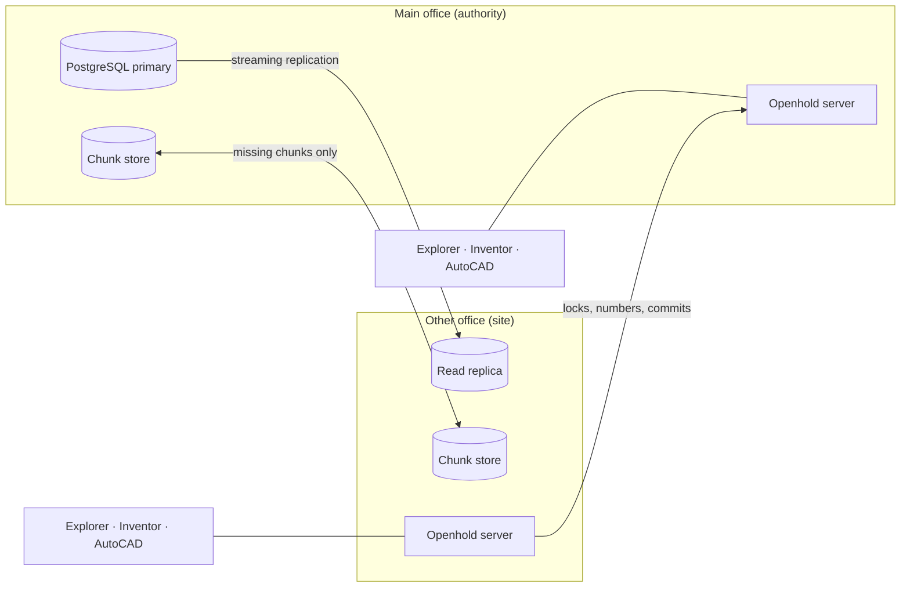

# Openhold

**Open-source product data management (PDM) for Autodesk Inventor and AutoCAD, built for teams spread across
offices and countries.**

Openhold keeps an engineering team's CAD files, drawings and documents in one vault: check-out and check-in,
versions and revisions, where-used, lifecycles and approvals, numbering, a part catalogue and ERP links. It is
designed to replace Autodesk Vault, and to do better at the thing multi-site teams struggle with most:
**speed between offices**. Every office has its own server with a full copy of the vault, so opening and getting
files runs at local network speed, while check-out locks stay correct across the whole company.

> **Status: public beta, and beta testers are wanted.** Expect rough edges, and try it on a copy of your data rather
> than your only one. See [Beta testing](#beta-testing) to get involved, and [Release 1.0](docs/release-1.0.md) for
> what is done and what is left.

## Try it

On any machine with Docker:

```sh
git clone https://github.com/bpbonker/openhold.git
cd openhold
cp .env.example .env      # then set OPENHOLD_DB_PASSWORD in .env
docker compose up -d
```

Then [set up a PC](docs/install/clients.md) and sign in as `admin`. The full guides cover
[Docker](docs/install/docker.md), [Ubuntu and Debian](docs/install/ubuntu-debian.md),
[Windows Server](docs/install/windows-server.md) and what's supported on each: [Installing Openhold](docs/install/README.md).

## Features

**Files and versions**
- Check-out / check-in / undo from Openhold Explorer, Inventor and AutoCAD (including AutoCAD Electrical projects,
  which check in and out as one set).
- Atomic check-ins: a whole assembly lands as one changeset or not at all, and retries never commit twice.
- Full history, Get Latest / Get Version, Uses and Where Used at any version, trash and restore.
- CAD file names are unique across the vault, so Inventor and AutoCAD never silently open the wrong file.
- Edit iProperties and title blocks from Openhold, for many files at once.

**Release control**
- Categories, lifecycles (e.g. Work in Progress → In Review → Released → Obsolete), approvals with sign-off rules,
  and released files locked against change.
- Revisions change only when someone chooses **Revise**. Check-in never bumps a revision.
- Released drawings are published as stamped PDFs with a QR code that shows whether a printout is still current.

**Numbering you build yourself**
- Administrators build numbering schemes from parts (fixed text, pick lists, typed values, folder codes, the
  parent assembly's number, counters, check digits, year, site), with no imposed format.
- Naming rules fill numbers from where a file is saved: **Save to Openhold** in Inventor suggests them, and check-in
  enforces them.
- Numbers are reservations: a cancelled save gives its number back, and an issued number is never reused.

**Catalogue and ERP**
- An item master with classes and attributes, approved manufacturers with duplicate checks, and legacy
  cross-references.
- Modular ERP connectors (CSV and simPRO included) that run as background jobs with retries, so a slow ERP never
  holds up engineering.

**Multi-site**
- One *authority* server decides every lock, number and commit; each office has a *site* server with a read
  replica and its own file store, so browsing, search and Get are served by the office's own server.
- Files are split into content-addressed chunks (FastCDC + BLAKE3), so sites copy only what they lack. Stored content
  never changes, so copies between offices can't conflict. A site cut off from the authority keeps browsing and getting files.
- An offsite *backup* server role.

**Security**
- Windows sign-in and Openhold accounts with two-factor codes; organisation accounts (OpenID Connect) on the server.
- Groups, privileges and folder permissions with "Explain why".
- Append-only audit trail and encrypted backups. Controls are mapped to SOC 2 in [docs/SECURITY.md](docs/SECURITY.md).

## How it fits together



| Component | What it is |
|---|---|
| `src/Openhold.Server` | ASP.NET Core server (authority, site or backup role): locks, check-in, numbering, lifecycles, catalogue, replication, REST API |
| `src/Openhold.Core` | Shared model: chunking, hashing, numbering templates, configuration, contracts |
| `src/Openhold.Client.Sdk` | Typed .NET client used by every Openhold client |
| `src/Openhold.Desktop` | **Openhold Explorer**, the WPF desktop app, including Administration |
| `src/Openhold.Inventor.AddIn` | Inventor add-in (2025 and later) |
| `src/Openhold.AutoCAD.Plugin` | AutoCAD, AutoCAD Mechanical and AutoCAD Electrical plugin |
| `src/Openhold.Jobs` | Job worker: published PDFs and other outputs |
| `src/Openhold.Import` | Bulk import of existing folders with their references |
| `src/Openhold.Admin` | Command-line administration |
| `tests/` | Unit tests and PostgreSQL-backed integration tests (Testcontainers) |
| `Dockerfile`, `compose.yaml` | The server image and a ready-to-run server with its database |
| `deploy/` | The development database, settings example and add-in manifests |
| `tools/` | Development, install and release scripts |

## Getting started (development)

Needs the [.NET 10 SDK](https://dotnet.microsoft.com/download) and Docker. The CAD add-ins also need Inventor or
AutoCAD installed on the same PC; Openhold never ships Autodesk files.

```sh
docker compose -f deploy/docker-compose.dev.yml up -d   # PostgreSQL on localhost:5433
dotnet run --project src/Openhold.Server --launch-profile http   # http://localhost:5080; migrates the database
dotnet run --project src/Openhold.Desktop                 # Openhold Explorer (Windows)
dotnet test                                              # integration tests start their own PostgreSQL
```

In development the server trusts an `X-Openhold-User` header for identity; production uses real sign-in.
To try the CAD side, see [Try the Inventor workflow](docs/try-inventor.md) and
[Try the AutoCAD workflow](docs/try-autocad.md).

## Documentation

| Guide | For |
|---|---|
| [Installing Openhold](docs/install/README.md) | Servers (Docker, Ubuntu/Debian, Windows Server) and PCs, and what's supported |
| [How-to guides](docs/howto/README.md) | Step-by-step tasks: set up a vault, add people, numbering, releasing, backups, adding an office |
| [User guide](docs/user-guide.md) | Everyday work: check-out, check-in, releasing, the catalogue |
| [Administration](docs/administration.md) | Sites, sign-in, permissions, numbering, ERP, backups, recovery |
| [Release workflows](docs/release-workflows.md) | Categories, lifecycles, revisions and approvals |
| [Security](docs/SECURITY.md) | Threat model and controls (SOC 2 mapping) |
| [Design measurements](docs/design-measurements.md) | Why the storage and transfer design is the way it is |
| [Roadmap](ROADMAP.md) | What is planned, including platforms not supported yet |

## Beta testing

Openhold is looking for engineering teams and CAD administrators to try it before 1.0, especially teams that use
Inventor or AutoCAD Electrical, or work across more than one office.

1. Set up a test server and a PC by following [Try it](#try-it), using **copies** of real projects, never your
   only copy.
2. Try the work you do every day: check-out and check-in from Inventor and AutoCAD, releasing and revising,
   numbering, Copy Design, and a second site if you have one.
3. Tell us what happened by opening a [beta feedback](../../issues/new?template=beta_feedback.yml) issue for
   impressions and missing features, or a bug report for something broken.

Please leave real drawings, part data and anything confidential out of public issues.

## Contributing

Contributions are welcome: bug reports, ideas, docs and code. Read [CONTRIBUTING.md](CONTRIBUTING.md), the
[Contributor Licence Agreement](CLA.md) and the [Code of Conduct](CODE_OF_CONDUCT.md) first. Please report
security problems privately, as described in [the security policy](.github/SECURITY.md), not in a public issue.

## Ownership and licence

Openhold was created by, and is the intellectual property of, Brenden Pieter Bonker. It is open source
under the [Apache License 2.0](LICENSE) and community driven: anyone may use, change and share
it, and contributions are welcome. Copies and derived works must keep the copyright and [NOTICE](NOTICE)
attribution; no one may present Openhold as their own creation or use its name to imply endorsement.

Autodesk, AutoCAD, Inventor and Vault are trademarks of Autodesk, Inc. Openhold is an independent project, not
affiliated with or endorsed by Autodesk. See [THIRD-PARTY-NOTICES.md](THIRD-PARTY-NOTICES.md) for the open-source
components Openhold uses.
